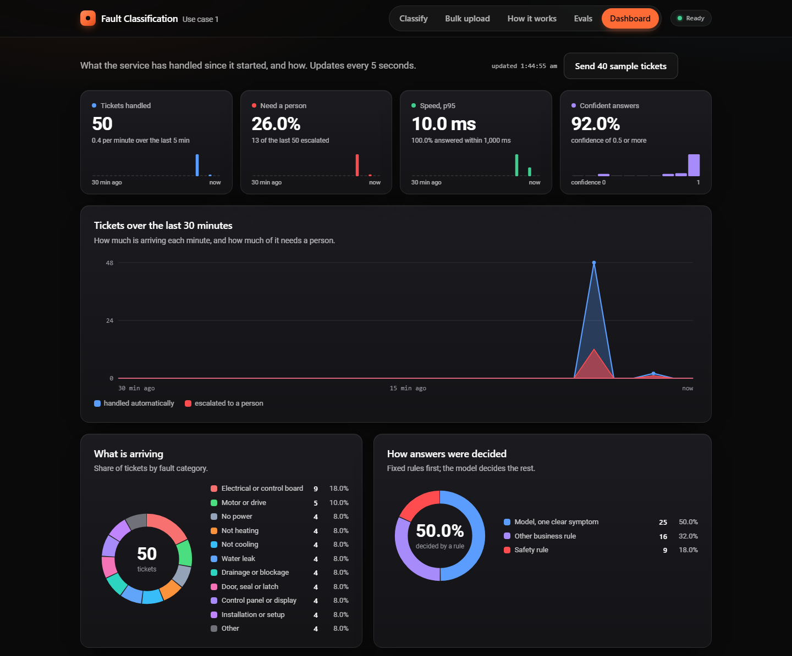
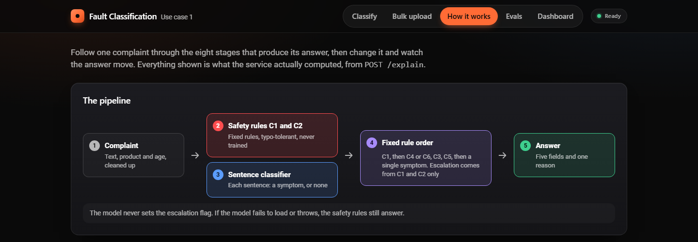

<p align="center">
  
</p>

<h1 align="center">Fault Classification Service</h1>

<p align="center">
  Reads an appliance complaint and returns the fault category, a confidence, an escalation flag and the business rule that decided it.<br>
  Runs fully offline on port 8000. No LLM and no external call at request time.
</p>

<p align="center">
  
  
  
  
  
  
  <br>
  
  
  
  
</p>

---

## Contents

- [Start](#start)
- [API](#api)
- [How it works](#how-it-works)
- [Results](#results)
- [The page](#the-page)
- [Tests](#tests)
- [Retrain and evaluate](#retrain-and-evaluate)
- [Layout](#layout)
- [References](#references)

## Start

Requires Python 3.10 to 3.13 and an internet connection for the first install only. After that the service needs no network.

```bash
python3 run.py
```

On Windows use `python run.py`. The command creates `.venv`, installs `requirements.txt` and starts the service on port 8000. Then open **http://localhost:8000/**.

<details>
<summary><b>If the page does not open</b></summary>

- **Use `http://localhost:8000/`.** The start-up log mentions `0.0.0.0:8000`; that means "listening on all network addresses" and is not an address a browser can open. On Windows it gives "This site can't be reached".
- **"The service is already running":** an earlier copy is still open. Use it at `http://localhost:8000/`, or stop it with Ctrl+C in its window before starting again. After pulling new code, always stop and start the service so it runs the new version.
- **"Port 8000 is being used by another program":** `run.py` prints the command to find and stop that program.
- **To start it by hand without `run.py`:** `python -m uvicorn app:app --host 0.0.0.0 --port 8000` from the project folder, with the packages in `requirements.txt` installed.

</details>

## API

| Method | Path | Purpose |
| --- | --- | --- |
| `POST` | `/classify` | Classify one ticket. Returns exactly five fields |
| `GET` | `/health` | Returns `{"status":"ok"}` |
| `GET` | `/` | The page |
| `POST` | `/explain` | The same answer plus the full trace shown on the How it works tab |
| `GET` | `/metrics`, `/scorecard` | Live counters for the Dashboard, and the stored offline evaluation |

```bash
curl -X POST http://localhost:8000/classify -H "Content-Type: application/json" -d '{"ticket_id":"T-1","product_category":"washing_machine","complaint_text":"drum never turns, display shows E21","product_age_days":410}'
```

```json
{
  "ticket_id": "T-1",
  "fault_category": "motor_or_drive",
  "confidence": 0.856,
  "escalate": false,
  "reason": "The only symptom described matches motor_or_drive."
}
```

A safety complaint is decided by a rule, and the reason names it:

```json
{
  "ticket_id": "T-2",
  "fault_category": "electrical_or_control_board",
  "confidence": 0.97,
  "escalate": true,
  "reason": "Rule C1: the complaint reports sparks, so it is an electrical fault and must be escalated."
}
```

`product_age_days` is optional. Wrong types, unknown products and empty text still get a valid five-field answer.

## How it works

<p align="center">
  
</p>

1. **Safety rules run first and are never trained.** Rules C1 and C2 read the full text for sparks, smoke, burning smells, fire, electric shock, tripped supply and gas smells, and repair one-letter typos. Only these two rules can set `escalate`. If the model fails to load or throws, they still answer.
2. **A small model classifies each sentence, not the whole complaint.** Word and character TF-IDF features plus keyword lists feed a logistic regression that labels every sentence as one of 11 symptom categories or "no symptom". This is what makes two-symptom tickets tractable.
3. **One function applies the business rules in a fixed order:** C1 (safety), C4 (error code only), C6 (not a complaint), C3 (new product with an installation problem), C5 (two symptoms: the earlier category wins and confidence is capped at 0.70), then a single symptom.
4. **Confidence is calibrated per decision path**, so a high number means the answer is more likely to be right.

The design decisions and what was left out are in [NOTES.md](NOTES.md). Where the data came from and how it was tested is in [DATA.md](DATA.md). How AI tools were used is in [AI.md](AI.md).

## Results

Measured by `python -m fault.evaluate`, which fails if any of its 13 limits is missed. The data repeats about 120 sentences, so a random split mostly measures memory; the two stricter schemes are the ones to read.

| Validation scheme | Macro-F1 over 12 categories |
| --- | --- |
| A. Random 5-fold (optimistic) | 0.992 |
| **B. Leave-template-out: wording never seen in training** | **0.974** |
| C. Trained on hand-written sentences only | 0.959 |

| Measure | Value | Limit |
| --- | --- | --- |
| Escalation recall (safety tickets caught) | 100% | must be 100% |
| False escalations | 0 | specificity at least 0.99 |
| Two-symptom accuracy (rule C5) | 0.992 | at least 0.95 |
| Calibration error (ECE) | 0.085 | at most 0.12 |
| Macro-F1 with 5% of letters corrupted | 0.888 | at least 0.84 |
| p95 latency per request | 10.6 ms | brief allows 1,000 ms |
| Training time | 25 s | brief allows 5 min |

**Known limit.** These figures come from template-built tickets. On 150 real incident reports labelled by hand, safety escalation held up, but the fault category was right only about 55% of the time when no safety word decided it. Expect lower category accuracy on long real narratives; see [DATA.md](DATA.md).

## The page

One HTML file, served by the service, with no external assets.

| Tab | What it shows |
| --- | --- |
| **Classify** | One ticket: the category, confidence, escalation flag and the rule that decided it |
| **Bulk upload** | A CSV or JSON file of tickets, with a summary by category and by rule. Try the files in `data/samples/` |
| **How it works** | One complaint traced through all eight stages, using what the service actually computed |
| **Evals** | The stored offline evaluation: per-category scores, confusions, calibration, release gates |
| **Dashboard** | Live traffic since start-up: volume, escalations, speed, confidence, product-by-fault heatmap |

## Tests

```bash
python -m pip install -r requirements-dev.txt
python -m pytest -q
```

The 401 tests block every connection that leaves the machine. `python scripts/check_repo.py` checks the submission rules (file sizes, no secrets, required files), and `python scripts/verify_clean.py` starts a fresh copy of the repo with the one start command and sends it the brief's examples.

## Retrain and evaluate

```bash
python -m fault.train
python -m fault.evaluate
```

`fault.train` rebuilds `model/sentence.joblib` in under a minute. `fault.evaluate` prints the scorecard, writes `model/scorecard.json` (shown on the Evals tab) and exits non-zero if a hard gate fails.

## Layout

```
run.py                 one command: install and start on port 8000
app.py                 API and page: /classify, /health, /, /explain, /metrics, /scorecard
fault/                 the engine
  labels.py            the 12 categories and 7 products from the brief
  rules.py             text clean-up, safety rules C1 and C2, error codes (no model imports)
  lexicon.py           keyword features
  model.py             sentence classifier
  decide.py            rule precedence C1 to C6 and the safe fallback
  kpis.py              live counters for the Dashboard
  sentences.py         sentence labels recovered from ticket labels
  train.py             training and confidence calibration
  evaluate.py          scorecard and hard gates
model/                 saved model, model card, scorecard
static/index.html      the page: Classify, Bulk upload, How it works, Evals, Dashboard
assets/                screenshots used in this README
data/
  training/            tickets.csv, seed_clauses.csv and its generator
  testing/             safety edge cases, hand-labelled real reports
  samples/             small files to try in the Bulk upload tab
tests/                 offline test suite
scripts/               repository check and clean-copy start check
README.md  DATA.md  NOTES.md  AI.md
```

## References

Four pieces of prior work informed the design. Each entry says which idea was taken and, just as plainly, what this project does not implement.

| # | Reference | Idea taken | What this project does not do |
| --- | --- | --- | --- |
| 1 | C. L. Forgy, "Rete: A Fast Algorithm for the Many Pattern/Many Object Pattern Match Problem," *Artificial Intelligence*, vol. 19, no. 1, pp. 17–37, 1982. | Keep business rules as explicit, inspectable conditions with a fixed order for resolving conflicts, separate from any learned component. This is the shape of `fault/decide.py`. | It does not build a Rete network. With six rules and one ticket per request, an ordered function is simpler and just as fast. |
| 2 | R. Cox, "Regular Expression Matching Can Be Simple And Fast (but is slow in Java, Perl, PHP, Python, Ruby, ...)," article, January 2007. | Text matching can take pathological time on adversarial input. An early safety scan took 43 seconds on a 1 MB complaint; it was rewritten to scan in linear time and the request body is capped at 64 KB. | It does not implement a Thompson NFA matcher. It uses Python's standard `re` module with simple patterns and bounded input. |
| 3 | P. Bojanowski, E. Grave, A. Joulin and T. Mikolov, "Enriching Word Vectors with Subword Information," *Transactions of the Association for Computational Linguistics*, vol. 5, pp. 135–146, 2017. | Represent a word by its character n-grams so that typos and unseen word forms still share features with known words. The classifier uses character n-grams of length 2 to 5 alongside word features. | It does not use fastText or any learned word vectors. The n-grams are TF-IDF counts fed to a logistic regression. |
| 4 | C. Guo, G. Pleiss, Y. Sun and K. Q. Weinberger, "On Calibration of Modern Neural Networks," *Proceedings of the 34th International Conference on Machine Learning (ICML)*, PMLR vol. 70, pp. 1321–1330, 2017. | Treat confidence as something to measure and correct after training: expected calibration error (ECE) and reliability diagrams as the measure, and a simple post-hoc scaling as the fix. | The model is not a neural network. It applies Platt scaling per decision path, the logistic method that the paper's temperature scaling is a one-parameter variant of. |
